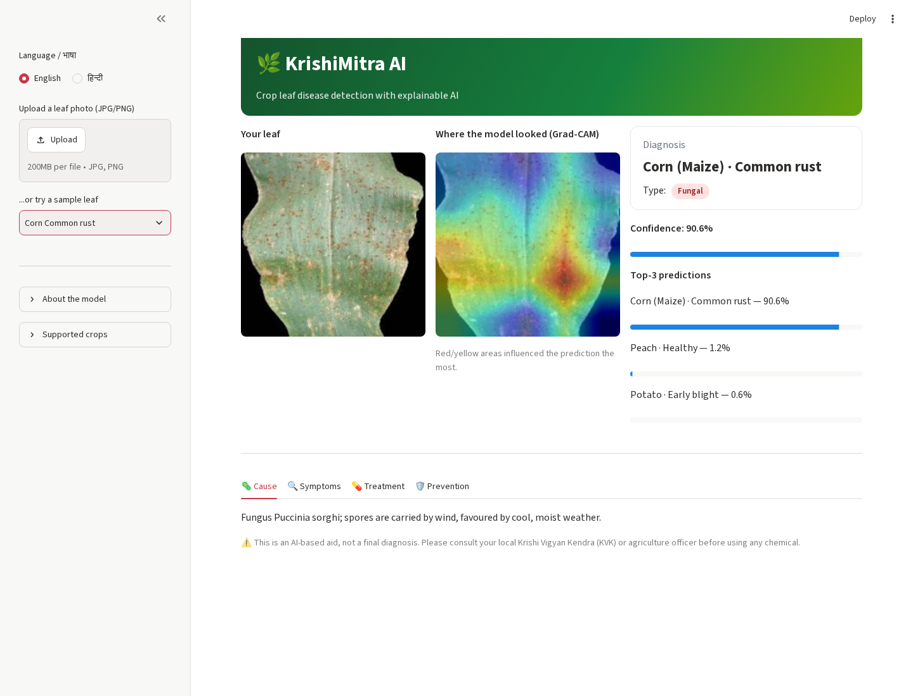
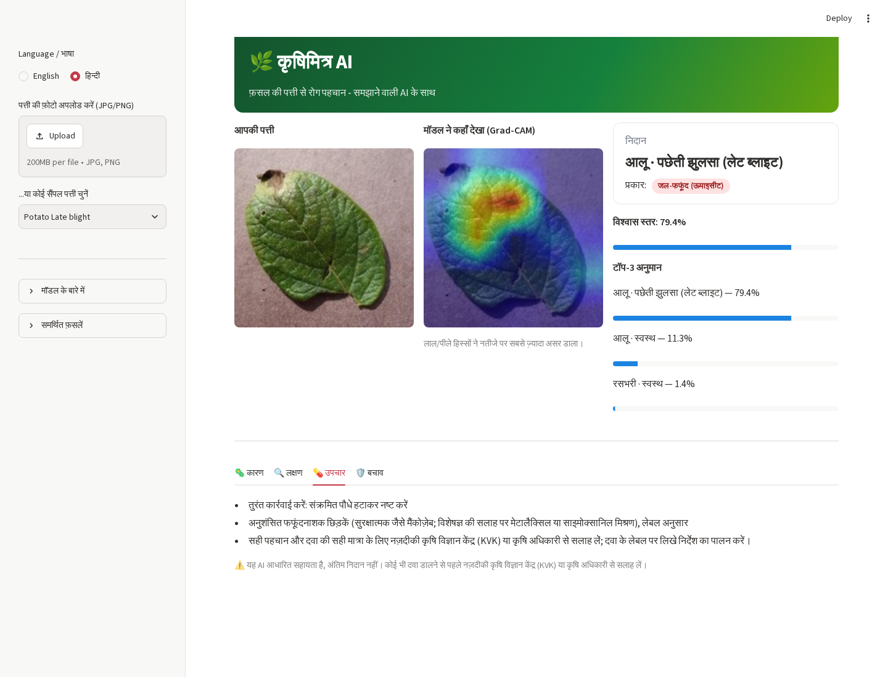
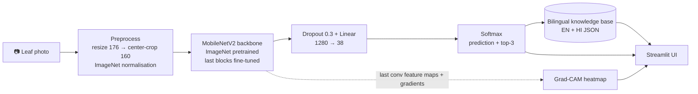
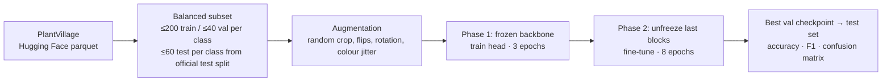
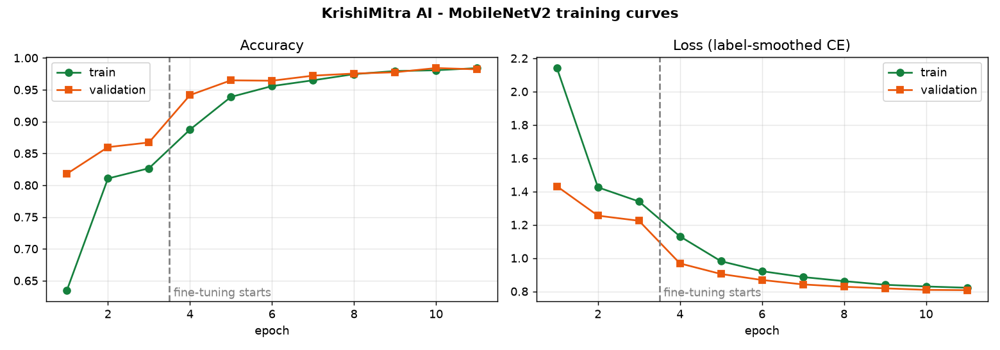
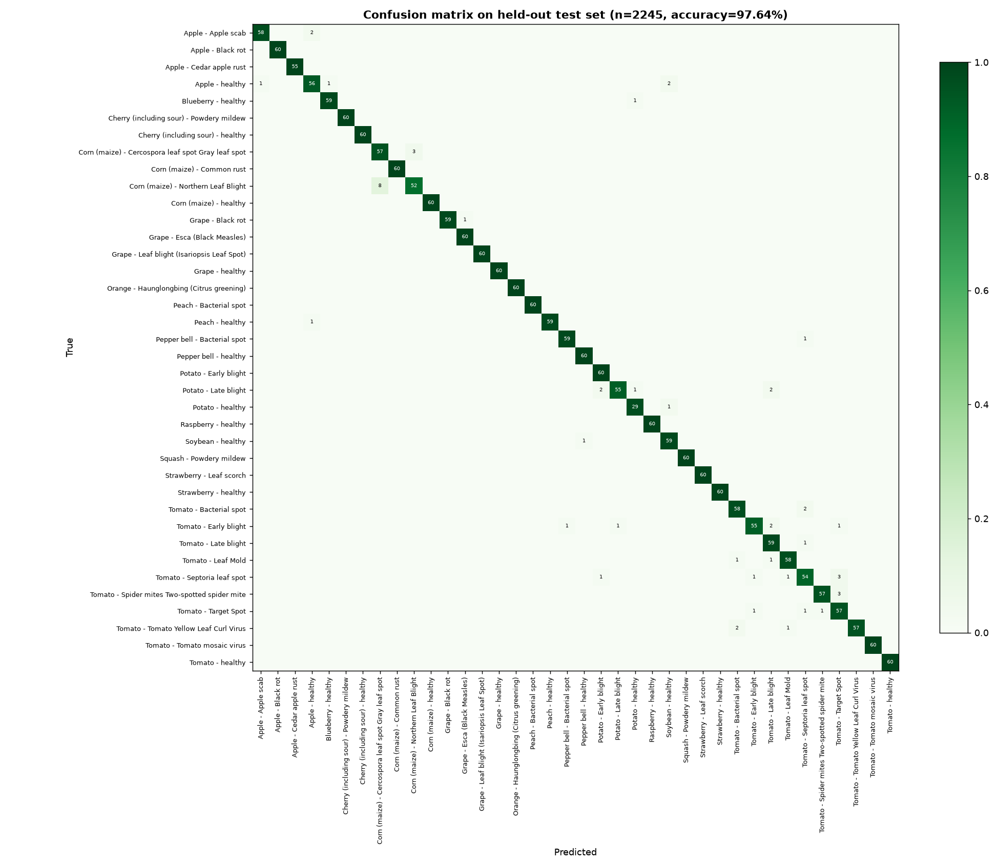
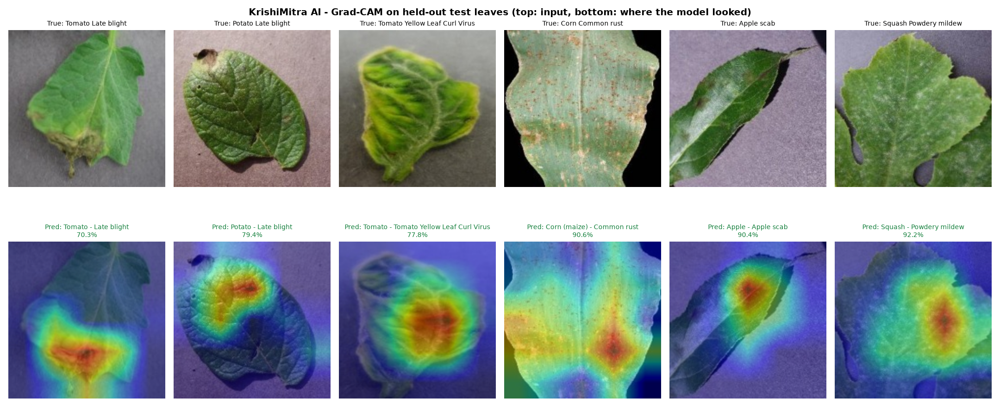

# 🌿 KrishiMitra AI — Crop Leaf Disease Detection with Explainable AI


**Upload a photo of a crop leaf → KrishiMitra AI identifies the crop and the disease (38 PlantVillage classes), shows *where* on the leaf the model looked (Grad-CAM heatmap), and explains the cause, symptoms, treatment and prevention in both English and Hindi (हिन्दी).**

> Test accuracy **97.64%** · Top-3 accuracy **99.96%** · Macro F1 **0.976** on 2245 held-out test images · model size **9.3 MB** (runs on CPU)

| English UI | हिन्दी UI (treatment tab) |
|---|---|
|  |  |

<sub>Screenshots captured from the running Streamlit app (headless Chromium, `scripts/screenshot.py`).</sub>

---

## 🌾 The problem

Plant diseases cause large crop losses every season, and many small farmers cannot get an expert to their field quickly. Most diseases are first visible on the **leaves**, so a phone photo is often enough for an early, first-level check. KrishiMitra ("friend of the farmer") gives:

1. **Instant diagnosis** from a single leaf photo,
2. **Explainability** — a Grad-CAM heatmap so the user can see that the model focused on the diseased spots, not the background,
3. **Actionable, bilingual advice** — cause, symptoms, treatment and prevention in English and Hindi, always pointing the farmer to the local Krishi Vigyan Kendra (KVK) for confirmation.

## ✨ Features

- 🔍 **38-class classifier** (14 crops, 26 diseases + 12 healthy classes) — MobileNetV2 transfer learning
- 🔥 **Grad-CAM heatmap** of the region that drove the prediction
- 📊 Confidence bar + **top-3 predictions**, with a low-confidence warning
- 🇮🇳 **English / हिन्दी toggle** for the whole UI and the remedy card
- 💊 Curated knowledge base (`data/knowledge_base.json`) for every class: cause, symptoms, treatment, prevention
- 🖼️ Sample leaves built in, so anyone can try it without their own photo
- ⚡ Lightweight: ~9.3 MB model, CPU-only inference in well under a second

## 🧠 Architecture



**Training pipeline**



## 📦 Dataset

- **PlantVillage** (Hughes & Salathé, 2015; used in Mohanty, Hughes & Salathé, *Frontiers in Plant Science*, 2016) — ~54k images of healthy and diseased leaves, 38 classes.
- Loaded from the public Hugging Face mirror [`BrandonFors/Plant-Diseases-PlantVillage-Dataset`](https://huggingface.co/datasets/BrandonFors/Plant-Diseases-PlantVillage-Dataset) (80/20 train/test parquet files).
- To keep training CPU-friendly, a **balanced subset** was used (seed 42): **7473 train · 1505 validation · 2245 test images** across **38 classes** (≤200 / ≤40 / ≤60 per class). The test images come from the dataset's own test split and were never used for training or model selection.

## 📈 Results (real, held-out test set)

| Metric | Value |
|---|---|
| Test accuracy | **97.64%** |
| Top-3 accuracy | **99.96%** |
| Macro F1-score | **0.976** |
| Weighted F1-score | **0.976** |
| Best validation accuracy | 98.41% |
| Test images / classes | 2245 / 38 |
| Backbone | MobileNetV2 (ImageNet), input 160×160 |
| Model file | `models/krishimitra_mobilenetv2.pt` (9.3 MB) |

Full per-class precision / recall / F1: [`reports/classification_report.txt`](reports/classification_report.txt) · raw numbers: [`reports/metrics.json`](reports/metrics.json)

Most frequent confusions on the test set: Corn (maize) - Northern Leaf Blight → Corn (maize) - Cercospora leaf spot Gray leaf spot (8); Tomato - Spider mites Two-spotted spider mite → Tomato - Target Spot (3); Tomato - Septoria leaf spot → Tomato - Target Spot (3). Weakest classes by F1: Corn (maize) - Northern Leaf Blight (F1 0.90), Tomato - Septoria leaf spot (F1 0.91), Corn (maize) - Cercospora leaf spot Gray leaf spot (F1 0.91).

**Training curves**



**Confusion matrix (test set)**



**Grad-CAM on held-out test leaves** (sample images bundled with the app) — the heat mostly sits on the lesions/spots rather than the background:



> ⚠️ **Honest limitation:** PlantVillage photos are taken in a lab on a plain background, so accuracy on real field photos (mixed backgrounds, multiple leaves, different lighting) will be lower. Several PlantVillage images also show the same physical leaf, which can make test scores optimistic. Fine-tuning on field images (e.g. PlantDoc) is the next step.

## 🚀 Run locally

```bash
git clone https://github.com/imganesh523-maker/krishimitra-ai.git
cd krishimitra-ai
pip install -r requirements.txt
streamlit run app.py
```

Open http://localhost:8501, pick a sample leaf in the sidebar or upload your own photo, and switch between English and हिन्दी.

**Re-train from scratch (CPU, ~40 min):**

**Quick smoke test (loads the model and predicts on every sample leaf):**

```bash
python tests/test_predict.py
```

```bash
python scripts/build_subset.py --out data/plantvillage_subset   # downloads PlantVillage from Hugging Face, builds balanced split
python train.py --data data/plantvillage_subset --head-epochs 3 --ft-epochs 8
python scripts/make_figures.py         # training curves + confusion matrix
python scripts/gradcam_gallery.py      # Grad-CAM examples
```

## 🗂️ Project structure

```
krishimitra-ai/
├── app.py                         # Streamlit app (EN/HI toggle, upload, Grad-CAM, remedy card)
├── train.py                       # two-phase transfer-learning training + test evaluation
├── src/
│   ├── model.py                   # MobileNetV2 model + transforms
│   ├── predictor.py               # inference + Grad-CAM implementation
│   └── classes.py                 # 38 class labels
├── data/knowledge_base.json       # bilingual cause/symptoms/treatment/prevention for all 38 classes
├── models/krishimitra_mobilenetv2.pt
├── reports/                       # metrics.json, classification_report.txt, history.json
├── assets/                        # screenshots, figures, sample leaves
├── tests/test_predict.py           # smoke test: model loads, predicts, Grad-CAM works
├── scripts/                       # dataset builder, figures, Grad-CAM gallery, knowledge-base builder, screenshot
├── requirements.txt
└── LICENSE (MIT)
```

## 🛠️ Tech stack

Python · PyTorch · torchvision (MobileNetV2) · Grad-CAM · scikit-learn (metrics) · Matplotlib · Streamlit · Hugging Face Datasets (parquet) · PyArrow

## 🔮 Future work

- ☁️ Deploy on **Hugging Face Spaces** (the README header above is already Spaces-ready: `sdk: streamlit`)
- 💬 **LLM chatbot** (Hindi/English) for follow-up questions like "how much should I spray?" grounded on the knowledge base
- 🌱 Fine-tune on real field photos (PlantDoc) + leaf segmentation to handle cluttered backgrounds
- 📱 Export to TFLite / ONNX for an offline Android app
- 🗣️ Voice output in Hindi and more Indian languages (Bhojpuri, Bengali, Telugu)

## 🙏 Credits

- Dataset: PlantVillage — D. P. Hughes & M. Salathé (2015), *An open access repository of images on plant health…*; S. P. Mohanty, D. P. Hughes, M. Salathé (2016), *Using Deep Learning for Image-Based Plant Disease Detection*.
- Grad-CAM: R. R. Selvaraju et al. (2017), *Grad-CAM: Visual Explanations from Deep Networks via Gradient-based Localization*.
- MobileNetV2: M. Sandler et al. (2018).

> **Disclaimer:** KrishiMitra AI is an educational project and a first-level aid, not a substitute for an agronomist. Always confirm the diagnosis and any chemical dose with your local Krishi Vigyan Kendra (KVK) and follow the product label.

## 👤 Author

**Ganesh Kumar** — B.Tech CSE (AI & ML), 2027
[GitHub](https://github.com/imganesh523-maker) · [LinkedIn](https://www.linkedin.com/in/ganesh-kumar-924192451/) · gkdeveloper75@gmail.com

Licensed under the [MIT License](LICENSE).
